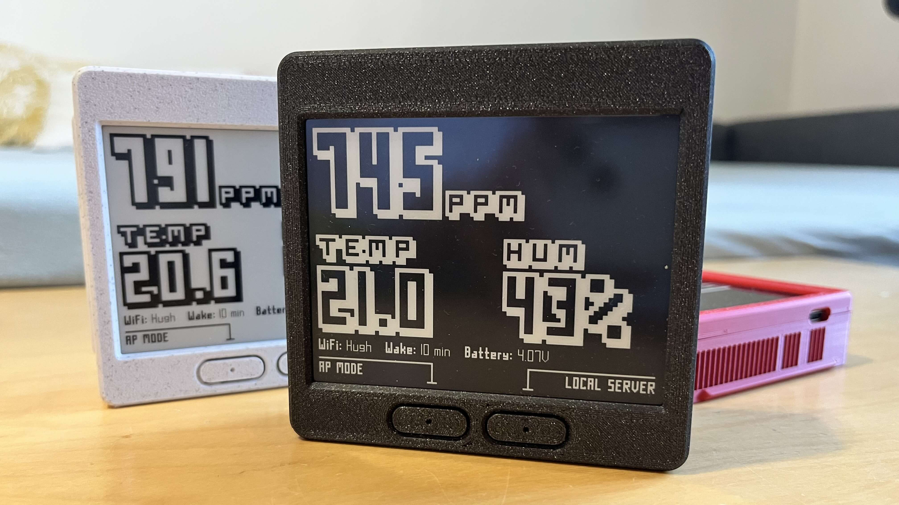
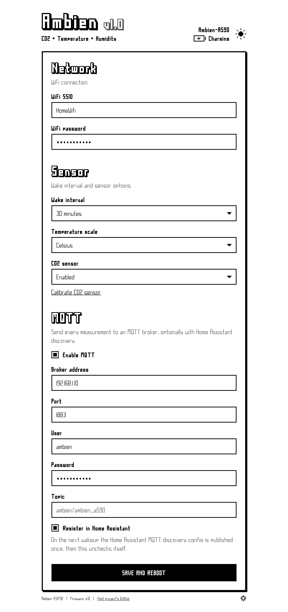

# Ambien

Ambien is an open source ESP32 based CO2, temperature and humidity sensor with a 4.2" e-paper display. It's made to sit on a shelf and be forgotten about: it wakes up, measures, refreshes the screen and goes back to deep sleep, so a single charge lasts up to a year. It is meant to be used with Home Assistant (or any other platform that supports MQTT) but it can also be used completely offline as a display.

To have some fun I went for a pixel design here, using my other project [PixelFonts](https://github.com/mcer12/PixelFonts) for a retro / paper look.

Device:


Web portal:


## Status
The project is considered done. Firmware, PCB files and 3D models are all included in the repo.

## Hardware

All pcb source files (EasyEDA) including gerber, schematic etc. are included in the pcb directory.

- **ESP32**: Massive overkill but I had some left so I used them
- **E-paper display**: 4.2" 400x300 black & white e-paper. HINK-E042A13-A0 or similar can be used (with the centered flex cable)
- **CO2, temperature, humidity**: Sensirion SCD4x for CO2 and SHT30 for temperature and humidity.
- **CO2 sensor is optional**: If you don't need it, disable it in the settings and the screen switches to a big temperature + humidity layout.
- **USB-C** for charging and upload / debugging
- **Long battery life**: The ESP32 spends almost all its time in deep sleep. WiFi is only on for the few seconds it takes to send the data and the CO2 sensor also runs in low power mode. Coupled with (insane) 2x 18650 slot, it runs up to a year with the CO2 sensor, and multiple years with the temperature / humidity sensor only.
- **Battery options**: You can omit the 18650 slots and battery protection and use a flat lipo battery instead
- **Integrated TP4057** lipo charger
- **Optional FS312F-G protection** chip with a higher cutoff threshold to save battery health

## Software
- **MQTT**: Every measurement is sent as one JSON message: temperature, humidity, CO2 and battery voltage.
- **Captive portal**: Simple, mobile-friendly web interface with a theme switch! Push a button and connect to its access point, or open it from your local network.
- **Home Assistant**: Checkbox to easily register the device in Home Assistant with all its sensors, via native MQTT discovery.
- **Offline mode**: No WiFi? No problem, it can work as display only.
- **CO2 calibration**: Forced recalibration to 430 ppm (fresh outdoor air) right from the web interface.
- **Battery indicator**: Battery voltage on the screen and in the web interface, with charging detection.

## Getting started

1. Flash the firmware (see below) and power it up. With no WiFi settings yet, it starts the setup access point **Ambien_XXXX** (XXXX is a part of the MAC address).
2. Connect to it with your phone or computer. The setup page should open on its own; if it doesn't, go to http://192.168.0.1.
3. Fill in your WiFi, pick the wake interval and optionally set up MQTT, then **Save and reboot**.

To change the settings later, push **AP MODE** (left button) or **LOCAL SERVER** (right button) on the sensor screen. If you don't want to use WiFi at all, push **OFFLINE MODE** on the "First run?" screen.

## MQTT & Home Assistant

Every wakeup publishes one message (not retained) to `<topic>/state`. The default topic is `ambien/ambien_xxxx`:

```json
{"temperature":23.5,"humidity":45,"co2":812,"battery":4.05}
```

Check **Register in Home Assistant** and on the next wakeup the device publishes a retained discovery config to `homeassistant/device/ambien_xxxx/config`. The checkbox then unchecks itself.

## Building

The project uses PlatformIO and all libraries are downloaded automatically.

```
pio run -t upload
```

Unit tests for the MQTT payloads: `pio test -e native` on a PC, or `pio test -e esp32dev` with the board connected.

## License:
GPL-3.0 License
